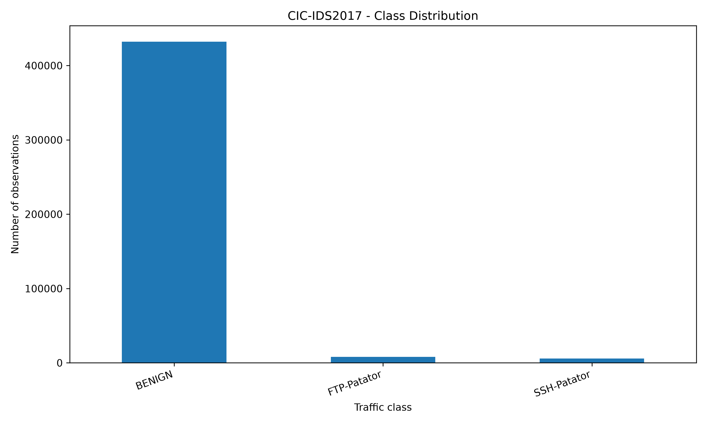
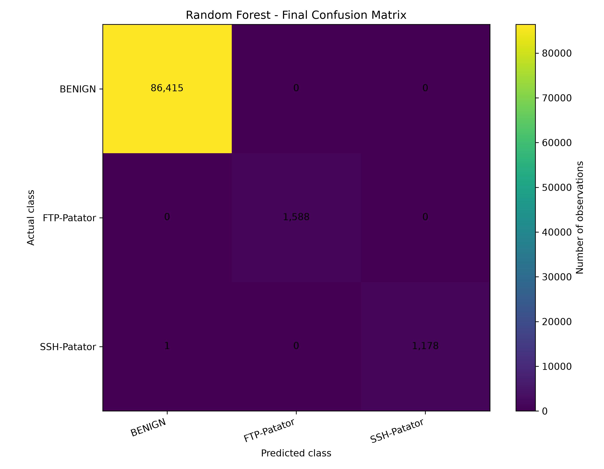
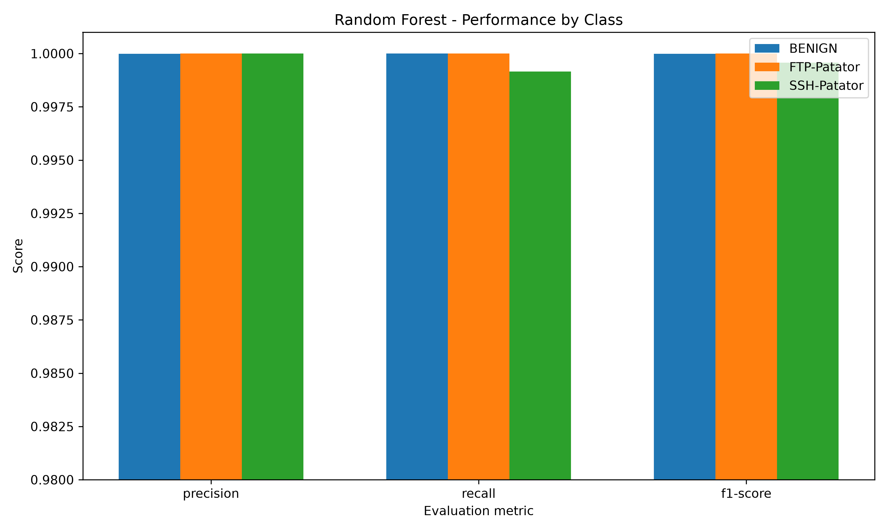
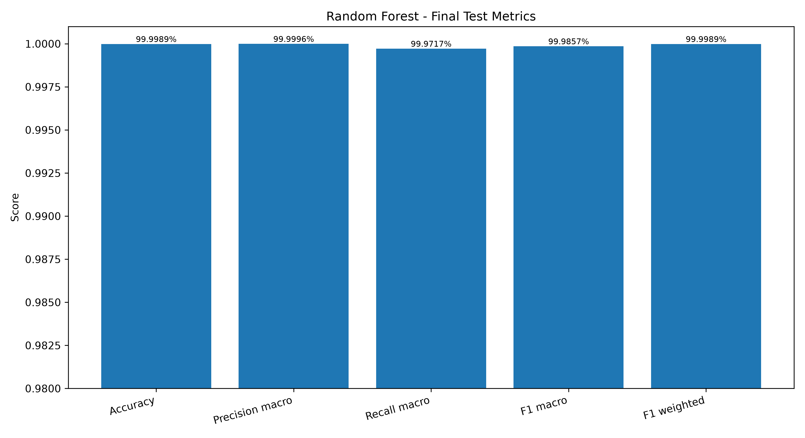
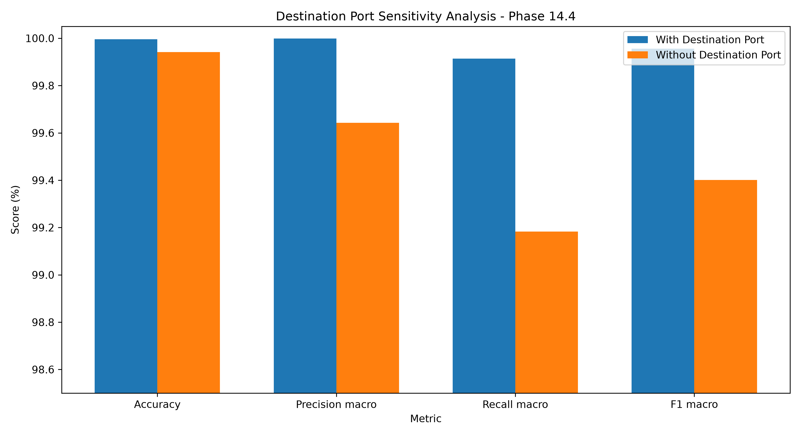

# 🛡️ Network Traffic Anomaly Detection Using Machine Learning

A Machine Learning-based Network Intrusion Detection System designed to identify FTP and SSH Brute Force attacks using the CIC-IDS2017 dataset and a Random Forest classifier.

The project includes a Streamlit web application for analyzing network traffic from CSV files, validating input data, detecting suspicious traffic, and visualizing model evaluation results.

## 📌 Project Overview

Network attacks such as FTP and SSH brute-force attempts can compromise systems through repeated authentication attempts.

This project applies supervised Machine Learning to network flow data to distinguish between:

- **BENIGN** — Normal network traffic.
- **FTP-Patator** — FTP brute-force attack traffic.
- **SSH-Patator** — SSH brute-force attack traffic.

## 🎯 Objectives

- Analyze network traffic using CIC-IDS2017.
- Prepare and validate network flow features.
- Train and evaluate Machine Learning models.
- Investigate data quality and potential data leakage.
- Evaluate model robustness using group-aware validation.
- Develop an interactive Streamlit application for traffic analysis.

## 🧠 Machine Learning Model

**Final model:** Random Forest Classifier

| Parameter | Value |
|---|---|
| Dataset | CIC-IDS2017 Tuesday Working Hours |
| Algorithm | Random Forest |
| Training samples | 356,727 |
| Original input features | 78 |
| Selected features | 68 |
| Number of estimators | 100 |
| Minimum samples per leaf | 2 |
| Class weighting | balanced_subsample |
| Random state | 42 |
| Output classes | 3 |

The final model is saved as a complete preprocessing and classification pipeline.

The application expects the original 78 input features. Feature selection is handled by the trained pipeline.

## 🏗️ Project Architecture

```text
Network-Traffic-Detector/
│
├── app.py
├── requirements.txt
├── README.md
├── .gitignore
│
├── .streamlit/
│   └── config.toml
│
├── src/
│   ├── phase8_verification.py
│   ├── phase9_eda.py
│   ├── phase10_data_preparation.py
│   ├── phase11_model_training.py
│   ├── phase12_model_optimization.py
│   ├── phase13_error_analysis.py
│   ├── phase14_2_group_aware_validation.py
│   ├── phase14_3_group_aware_random_forest.py
│   ├── phase14_4_destination_port_sensitivity.py
│   ├── phase15_finalize.py
│   ├── train_final_model.py
│   └── evaluate_final_model.py
│
├── models/
│   ├── random_forest_final_pipeline.pkl
│   └── random_forest_final_metadata.json
│
├── results/
│   └── figures/
│
└── rapport/
    └── captures/
```

## 📊 Project Workflow

1. Dataset verification and data quality analysis.
2. Exploratory Data Analysis (EDA).
3. Duplicate and data integrity analysis.
4. Data preparation and feature selection.
5. Machine Learning model training.
6. Model optimization and comparison.
7. Error analysis.
8. Group-aware validation and robustness analysis.
9. Final model selection and evaluation.
10. Streamlit application development.

## 📈 Visual Results

### Class Distribution


### Confusion Matrix


### Class Performance


### Global Metrics


### Destination Port Comparison


## 🖥️ Streamlit Application

The web application provides:

- Project dashboard and classification overview.
- CSV file upload and network traffic analysis.
- Input data quality validation.
- Prediction of BENIGN, FTP-Patator, and SSH-Patator traffic.
- Analysis summaries and downloadable results.
- Final model evaluation visualizations.

## ⚙️ Installation

### 1. Clone the repository

```bash
git clone https://github.com/bouazzahyassine/Network-Traffic-Detector.git

cd Network-Traffic-Detector
```

### 2. Create a virtual environment

```bash
python -m venv .venv
```

Activate it on Linux:

```bash
source .venv/bin/activate
```

### 3. Install dependencies

```bash
pip install --upgrade pip
pip install -r requirements.txt
```

## 🚀 Run the Application

Start the Streamlit application:

```bash
streamlit run app.py
```

Open the local URL displayed in your terminal, usually:

```text
http://localhost:8501
```

## 📂 Dataset

This project uses the **CIC-IDS2017** dataset, specifically the Tuesday Working Hours traffic.

The dataset is not included in this repository.

Users must obtain the dataset separately from the official Canadian Institute for Cybersecurity:

https://www.unb.ca/cic/datasets/ids-2017.html

The application analyzes CSV network-flow data using the feature structure expected by the final model.

## 📦 Model Files

The repository includes:

- `random_forest_final_pipeline.pkl` — Final trained preprocessing and classification pipeline.
- `random_forest_final_metadata.json` — Model configuration, feature information, and training metadata.

The original dataset and intermediate experimental models are excluded.

**Security note:** Only load trusted model files. Pickle-based model files can execute code when deserialized.

## 🔬 Technologies

- Python
- Pandas
- NumPy
- Scikit-learn
- Joblib
- Matplotlib
- Seaborn
- Streamlit
- Git and GitHub

## ⚠️ Limitations

- The model is trained on a specific subset of CIC-IDS2017.
- The three output classes are limited to BENIGN, FTP-Patator, and SSH-Patator.
- Results on other datasets and real-world traffic may differ.
- This project is an academic research prototype and should not be considered a replacement for a production-grade IDS.

## 👨‍💻 Author

**Yassine Bouazzah**

Master's project — Cybersecurity

## 📄 License

No license has been assigned yet. All rights are reserved by the author unless a license is added to this repository.
